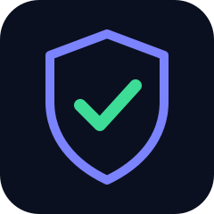
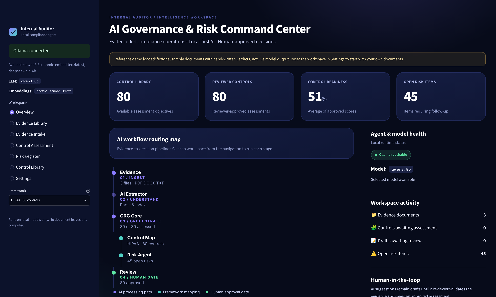
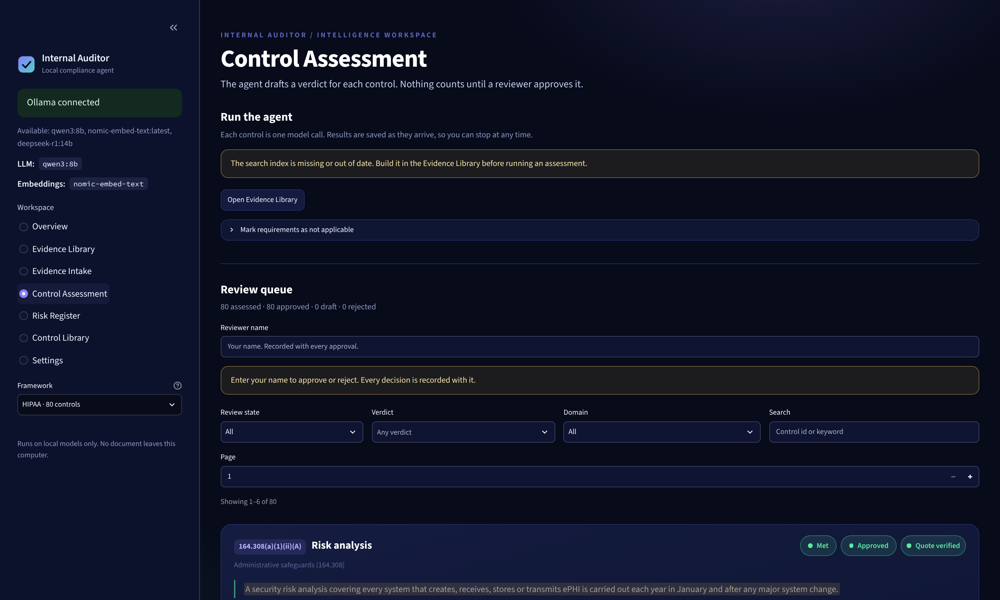
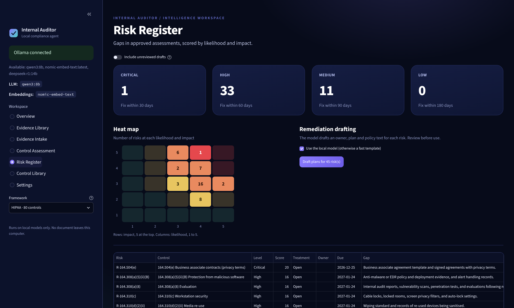
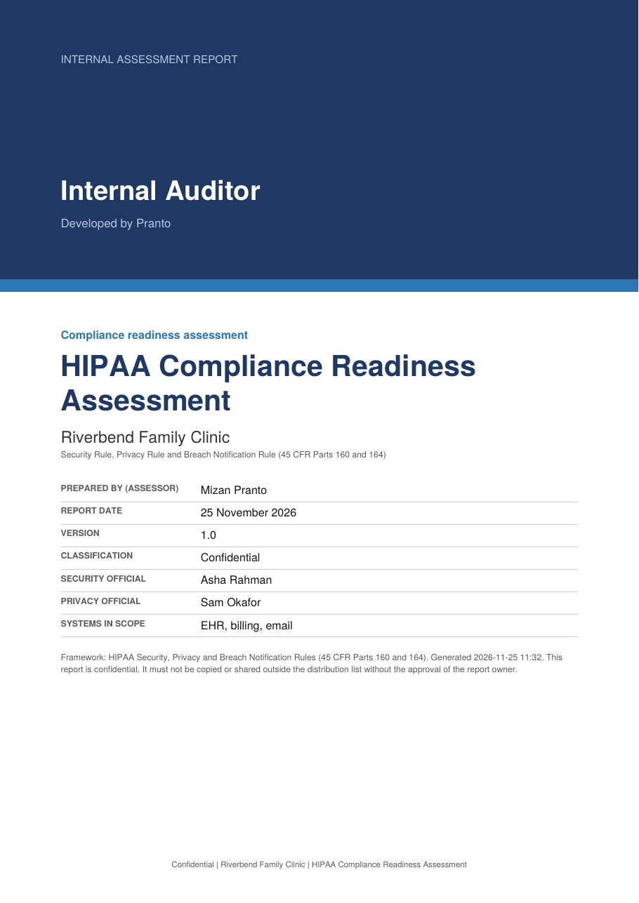
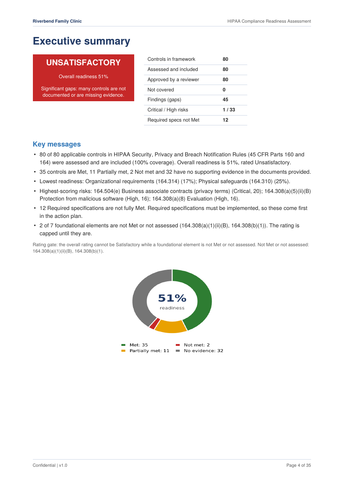
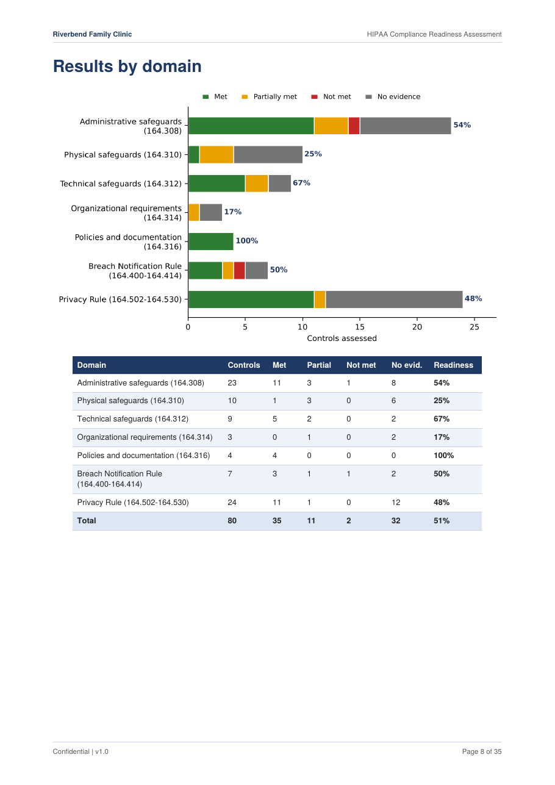
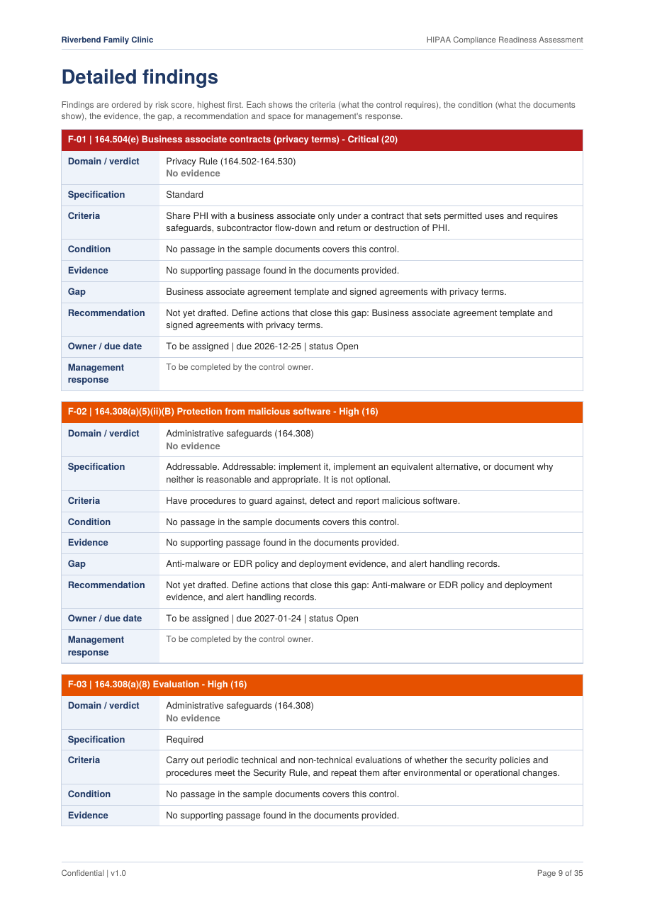
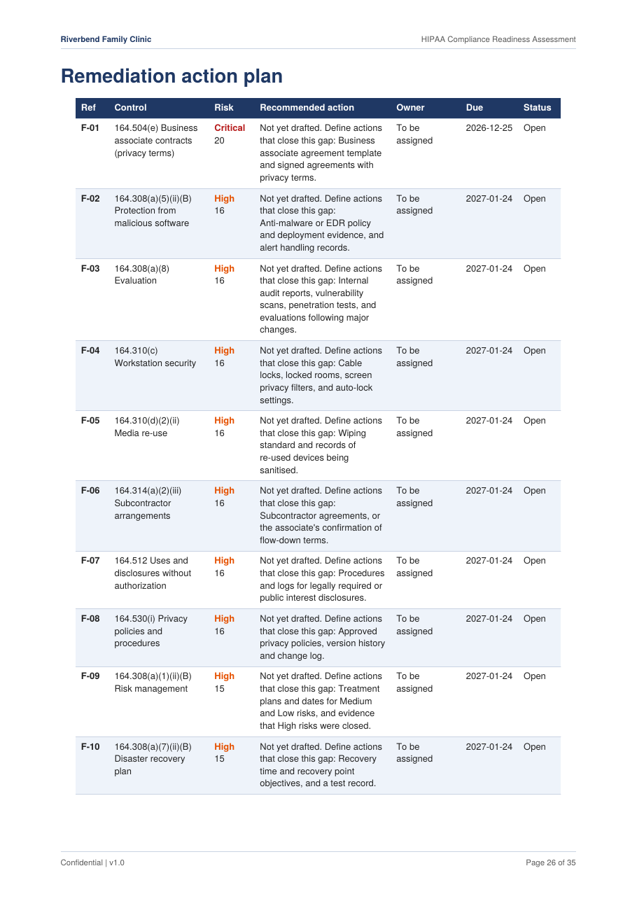

<div align="center">



# Internal Auditor

**An AI-assisted internal audit assistant that keeps its receipts.**

*Free and open source (MIT). Developed by Pranto.*


[Status](#project-status) · [Screenshots](#screenshots) · [How it works](#the-two-rules-that-make-it-credible) · [Frameworks](#frameworks) · [Setup](#setup-macos-or-linux) · [Contributing](CONTRIBUTING.md) · [Known limits](#known-limits)

</div>

---

## Project status

> **I am building this. It is not finished yet, and everyone is welcome to contribute.**
>
> Internal Auditor is an early prototype. The demo uses fictional documents with hand-written verdicts. Its accuracy against real audit judgements has **not** been benchmarked yet, and it has not been tested at scale. It supports a qualified reviewer and does not replace one. Please do not use its output as an audit opinion or certification.

Internal Auditor is a self-hosted assistant for internal audit and compliance work. You give it your policies and evidence and choose a framework. A local model (Qwen3:8B through Ollama) drafts a verdict for every control, and a named person has to approve each one before it counts. Gaps become a scored risk register and a PDF or Word assessment report. Your documents never leave your computer.

- **It cites, it doesn't guess.** Every verdict needs a quote that appears word for word in your document. A quote that is not found is rejected.
- **Humans decide.** The AI only drafts. A reviewer approves, overrides (with a note naming the evidence) or marks a control not applicable with a written reason.
- **One audit trail.** Approved verdicts store a hash of the document they relied on, and the action log is hash-chained, so edits are detectable.
- **Six frameworks, and yours.** ISO 27001, SOC 2, NIST CSF 2.0, HIPAA (with an evidence form anyone can fill in), GDPR and ISO 42001. Add another as a JSON file.
- **Local and model-agnostic.** Runs on Ollama with no API fees. The model, embedding model and settings are yours to change.

### Where help is most welcome

- A benchmark that compares model verdicts with experienced auditors' verdicts.
- More frameworks (NCA ECC and DCC, PCI DSS, NIST 800-53, CIS Controls, ISO 27701, EU AI Act), written as your own paraphrases.
- Evidence type and age tagging, sampling records, remediation tracking.
- Arabic and other multilingual document support.
- Real login and reviewer independence for shared use.
- Translations, documentation and bug reports.

See [CONTRIBUTING.md](CONTRIBUTING.md) to get started.

## Screenshots



| Control assessment with verified quotes | Risk register and report |
|---|---|
|  |  |

*Screenshots show the reference demo (fictional clinic, hand-written verdicts), not live model output.*

## Results: the assessment report

The report is generated as PDF and Word from the approved verdicts. These pages come from the demo HIPAA assessment of a fictional clinic (35 pages in total).

| Cover page | Executive summary |
|---|---|
|  |  |

| Results by domain | Detailed findings |
|---|---|
|  |  |

| Remediation action plan |
|---|
|  |

*The sample data is fictional and the verdicts are hand-written, so these pages show the report layout, not a real organisation's result.*

---

## The two rules that make it credible

1. **Citation lock.** A control is only rated Met, Partially met or Not met if the model quotes a passage that is
   then verified to exist in your documents (case, punctuation and markup are ignored, light fuzziness is allowed).
   If the quote cannot be found, the verdict is downgraded to *No evidence* and flagged for review. This stops a
   small model from inventing compliance.
2. **Human approval gate.** Model output is a *draft*. Readiness, the risk register and the exports only use
   assessments a named reviewer approved. A reviewer who upgrades a verdict that has no verified quote must write
   a note saying which evidence they checked. Every decision is logged with the reviewer's name.

> The lock proves a quote is real, not that it proves the control. This tool reviews documents only; it does not
> test whether controls operate effectively. A human still owns the conclusion.

## The seven workspaces

| Page | What it does |
|---|---|
| Overview | Live KPIs, the pipeline map, model health, workspace activity, top risks |
| Evidence Library | Upload PDF, DOCX, TXT or MD files, preview the passages, build the search index |
| Evidence Intake | Share a form so control owners can answer and upload evidence. You review each response before it counts |
| Control Assessment | Run the agent on 10, all or chosen controls. Review each draft: approve, reject, change the verdict, add a note |
| Risk Register | Heat map, likelihood x impact scores, remediation drafts, owner and due date, treatment status, Excel and Markdown export, and the **internal assessment report** (PDF and Word) |
| Control Library | Browse and search the controls, tune each control's impact weight, add your own framework |
| Settings | Models, context window, temperature, thinking mode, connection check, reset |

## Not-applicable controls

Some requirements do not apply to every organisation (a hospital is not a health care clearinghouse). On **Control
Assessment**, open *Mark requirements as not applicable*, pick the requirements and write a justification. It is
recorded under your name and is left out of readiness scores, risks and model runs (the model can never decide this
itself). The audit report lists each one with its justification in an appendix so an auditor can challenge it.
Change your mind any time with *Change verdict* on the control.

## Frameworks

Switch in the sidebar. Each framework keeps its own assessments, so switching back never loses work.

| Framework | Controls |
|---|---|
| ISO/IEC 27001:2022 Annex A | 93 |
| SOC 2 Trust Services Criteria (Security, Availability, Confidentiality) | 38 |
| NIST Cybersecurity Framework 2.0 (at category level) | 22 |
| HIPAA Security, Privacy and Breach Notification Rules (45 CFR Part 164) | 80 |
| Your own JSON file (upload in Control Library) | any |

Control IDs and short titles follow the frameworks. The summaries and evidence hints are paraphrased, not the
text of the standards; use your licensed copy for authoritative wording. Impact weights are generic defaults.

## Setup (macOS or Linux)

```bash
# 1. models (qwen3:8b is already installed if `ollama run qwen3:8b` worked)
ollama pull qwen3:8b
ollama pull nomic-embed-text

# 2. python 3.10+
cd pranto-grc-prototype  # the unzipped folder
python3 -m venv .venv && source .venv/bin/activate
pip install -r requirements.txt

# 3. run
streamlit run app.py
```

Make sure Ollama is running (the llama icon in the menu bar, or `ollama serve`).

## First run

1. **Evidence Library**: drop in your documents, then **Build search index**.
2. **Control Assessment**: enter your name, then **Run assessment**. Start with the first 10 controls.
3. Review the drafts. Each card shows the verbatim quote, its source file and page, and the model's reasoning.
   Approve, reject, or change the verdict. *Approve citation-verified drafts* does the safe ones in one click.
4. **Risk Register**: draft remediation plans, set owners and dates, then **Prepare reports** to download.

Want to look around first? **Load reference demo** (Overview or Settings) fills the workspace with three fictional
policies and hand-written verdicts. The demo is clearly labelled and is not model output.

## HIPAA assessments

Choose **HIPAA** in the sidebar. The framework has 80 requirements: the 49 Security Rule specifications (each marked
**Required** or **Addressable**), 24 Privacy Rule standards and 7 Breach Notification Rule requirements, with
45 CFR citations. Seven foundational elements (risk analysis, risk management, security official, privacy official,
training, business associate contracts, breach risk assessment) act as a rating gate: the overall rating cannot be
Satisfactory while one is not Met. The HIPAA report adds a regulatory overview, a foundational-elements table, a
Required versus Addressable breakdown, and HIPAA-specific limitations (it is not a legal opinion and not the
enterprise-wide risk analysis that 164.308(a)(1)(ii)(A) requires). **Load reference demo** with HIPAA selected loads
three fictional clinic policies from `sample_docs_hipaa/`.

## Evidence intake form (let anyone answer and upload evidence)

Control owners should not need access to your assessments. Share a separate, form-only app:

```bash
# terminal 1: your assessment app
streamlit run app.py
# terminal 2: the form for everyone else
streamlit run intake_app.py --server.port 8502 --server.address 0.0.0.0
```

People on your network open `http://<your-ip>:8502`. The **Evidence Intake** page shows the address, lets you set an
access code, create requests ("Asha: send the audit logging settings"), and review responses. A contributor enters
who they are, picks a requirement (sees what it means and what evidence helps), answers a short questionnaire and
uploads PDF, DOCX, TXT, MD, PNG or JPG files. Nothing counts until you press **Accept**. Accepted answers become a
labelled, self-attested evidence document (the report counts them) and readable files join the Evidence Library.
Then rebuild the index and run the assessment.

Safeguards: patient identifiers such as Social Security numbers, MRNs and dates of birth are blocked in the form and
flagged inside uploaded documents; file contents must match their type; size and count limits apply; filenames cannot
escape their folder. **Do not collect PHI through this form.** The form is plain HTTP on your own network and
contributors are identified only by what they type, so use a VPN or a protected tunnel and the access code for anyone
outside your network, and treat answers as self-attested.

## Internal assessment report (PDF and Word)

At the bottom of **Risk Register**, fill in the report details once (they are saved in the workspace):
company name, who did the assessment and their role, approver, auditee contact, scope, assessment period,
engagement reference, report title and date, version, classification, distribution list, "agent developed by"
(default *Pranto*) and an optional company logo. **Generate audit report** then gives you a PDF and a Word file.

Appendix A lists each document with its SHA-256 so the exact files reviewed can be identified, and the document-control
page records the model settings used. Both formats contain the same content: cover page (agent name, developer, company, assessor, approver and the other
details), contents, document control, executive summary with an overall rating (Satisfactory, Needs improvement
or Unsatisfactory, thresholds printed in the report), scope, approach and rating scales, results by domain with
charts, detailed findings (criteria, condition, verified evidence, gap, recommendation, owner, due date and a
blank management response), a remediation action plan, appendices (documents reviewed, every control's result,
limitations) and a sign-off block. Only reviewer-approved assessments are included unless you tick the drafts box.
The report states how many controls were not covered, so the rating is never presented as more than it is.
In Word, right-click the contents list and choose Update Field to show page numbers.

## Size and responsive layout

The interface renders at 80% of its original size (20% smaller). Change `UI_SCALE` in `grc_copilot/theme.py`
(1.0 = original) if you want it larger or smaller. The layout adapts at 1100, 820 and 480 px: KPI cards go from
four to two to one column, side-by-side columns stack on tablets, the sidebar collapses on phones, and the
pipeline map becomes a vertical list below 760 px.

## Tuning for Qwen3:8B

- Rough speed on a laptop with a recent GPU or Apple silicon: 5 to 15 seconds per control. Remediation drafts take
  about as long per gap. Results are saved as they arrive, so you can stop and continue.
- `Context window` defaults to 8192. Ollama's own default is small and silently truncates prompts.
- Thinking mode is off by default (faster, cleaner JSON). Turn it on in Settings for harder calls.
- If the agent misses evidence that exists, raise *Excerpts per control*. If it is too generous, lower it and
  look at the flagged items.
- Other models installed in Ollama (for example `deepseek-r1:14b`) appear in Settings. Larger or reasoning
  models are slower; check the quality on a few controls first.

## Files and data

Everything lives in `./workspace/` (or the folder in the `COPILOT_WORKSPACE` environment variable):
`state.json` (assessments, reviews, risks, activity log), `evidence/`, `index/`, `exports/`.
Delete the folder or use **Reset workspace** to start clean.

```
app.py                       the web app (six pages)
cli.py                       command line version for quick batch runs (no review workflow)
frameworks/                  iso27001_2022.json, soc2_tsc.json, nist_csf_2.json, hipaa.json
intake_app.py                the form-only app for evidence contributors
sample_docs/, sample_docs_hipaa/   fictional demo documents
grc_copilot/
  workspace.py   persistent state, review workflow, per-framework work
  engine.py      index building, retrieval, assessment, remediation
  assessor.py    prompts, structured output, the citation lock
  store.py       hybrid retrieval (embeddings + BM25), no external database
  ingest.py      reading and chunking PDF, DOCX, TXT, MD
  risk.py        likelihood x impact scoring and due dates
  report.py      Excel and Markdown reports
  audit_model.py audit_pdf.py audit_docx.py   the internal assessment report (one model, two writers)
  intake.py      evidence requests, submissions, review, PHI warnings
  theme.py       all HTML and CSS for the dark interface
  demo.py        the labelled reference demo
tests/           114 tests; run offline with a fake model
```

## Tests and trying the UI without a model

```bash
python -m pytest -q
python tests/fake_ollama.py 11500        # a stand-in Ollama (NOT a real model)
OLLAMA_URL=http://127.0.0.1:11500 streamlit run app.py
```

The tests cover the citation lock (made-up quotes are downgraded), chunking, retrieval, scoring, the Ollama HTTP
client, the review rules, per-framework state, HTML escaping of untrusted text, and the full pipeline.
The interface was also exercised end to end in a browser against the stand-in server. It has **not** been run
against a real Qwen3:8B inside this project's build environment, so check the quotes on your first run.

## Known limits

- Document review only. Operating effectiveness needs sampling, configuration checks and interviews.
- Scanned PDFs need OCR first.
- A real quote can still be about a different topic than the control, which is why every finding shows its quote
  and source for a human to confirm.
- AI-drafted remediation and policy text are starting points and must be reviewed by a qualified person.
- The assessment runs while the page is open. Leaving the page stops the run, but finished controls are kept.

## Ideas for next steps


1. Subcontrol-level NIST CSF and Processing Integrity / Privacy criteria for SOC 2.
2. Operating evidence: ingest scanner exports, access review exports and ticket exports.
3. Evidence freshness checks (policy last reviewed more than 12 months ago).
4. A second-opinion pass: assess twice and flag disagreements for review.

## Audit trail

- **Evidence snapshot.** Approving a verdict stores the SHA-256 of the cited document. If the file changes or disappears later, Control Assessment shows a warning.
- **Tamper-evident log.** Every action is also appended to `workspace/audit_log.jsonl`, with each entry hashing the one before it. Settings shows whether the chain is intact. This detects edits; it does not stop someone with file access from rewriting the whole file.
- **Overrides.** Changing a verdict to Met or Partially met needs a note that names the evidence file you checked. The model's original verdict is kept next to the final one.

